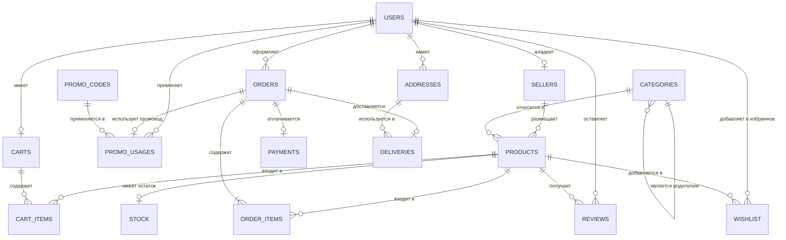

# Лабораторная работа №1. Проектирование и создание структуры базы данных

## 1. Анализ предметной области и бизнес-правила

### Описание предметной области

Разрабатываемая база данных обслуживает маркетплейс — электронную площадку,
объединяющую независимых продавцов и покупателей. Продавцы размещают товары
в каталоге, покупатели просматривают товары, добавляют их в избранное или
в корзину, оформляют заказы, которые оплачиваются и доставляются. Заказ
может быть оформлен с применением промокода.

Относительно базового кейса предметная область расширена двумя блоками:

- **промокоды** — общие скидочные коды с ограничением по сроку действия и
  количеству применений;
- **избранное** — пользователь может сохранять товары в избранное.

### Основные сущности

| Сущность | Назначение |
|---|---|
| users | учётные записи площадки |
| sellers | магазины, размещающие товары |
| categories | иерархический классификатор товаров |
| products | карточки товаров |
| stock | складские остатки |
| carts / cart_items | корзина и её позиции |
| orders / order_items | заказы и их позиции |
| payments | оплата заказов |
| deliveries / addresses | доставка и адреса |
| reviews | отзывы покупателей |
| promo_codes | промокоды на скидку |
| promo_usages | факты применения промокодов к заказам |
| wishlist | избранные товары пользователя |

### Бизнес-правила

**Пользователи и продавцы**

1\. Пользователь может быть покупателем и одновременно владельцем не более
чем одного магазина-продавца.

2\. Email пользователя уникален.

**Каталог**

3\. Товар принадлежит ровно одному продавцу и ровно одной категории.

4\. Категория может иметь родительскую категорию; категория без родителя —
корневая.

5\. Цена товара строго положительна.

6\. Название категории уникально.

**Складские остатки**

7\. Остаток товара на складе неотрицателен; товар нельзя продать в
количестве, превышающем остаток.

**Избранное**

8\. Один пользователь может добавить один и тот же товар в избранное только
один раз.

**Корзина и заказы**

9\. У пользователя не более одной активной корзины.

10\. Заказ принадлежит одному покупателю и содержит хотя бы одну позицию.

11\. Позиция заказа хранит цену товара на момент покупки, независимо от
последующего изменения цены товара в каталоге.

**Промокоды**

12\. Промокод действителен только в интервале `[valid_from, valid_until]` и
только пока активен (`is_active = true`).

13\. Один заказ может использовать не более одного промокода.

14\. Число применений промокода не превышает установленный лимит
(`usage_limit`), если лимит задан.

15\. Сумма скидки фиксируется в момент применения промокода к заказу и не
пересчитывается при последующем изменении параметров промокода.

**Оплата и доставка**

16\. Заказ может быть оплачен не более чем одним платежом.

17\. Заказ доставляется по ровно одному адресу, принадлежащему покупателю.

**Отзывы**

18\. Отзыв оставляется конкретным пользователем к конкретному товару.

19\. Отзыв на товар может оставить только пользователь, ранее купивший этот
товар (проверка реализуется серверной логикой в лабораторной работе №5;
здесь правило зафиксировано как ограничение предметной области).

## 2. Концептуальная ER-диаграмма

Диаграмма описывает сущности предметной области и связи между ними без
привязки к типам данных и реализации в конкретной СУБД. Всего выделено
16 сущностей. Схема содержит несколько связей «многие-ко-многим»,
реализуемых через ассоциативные таблицы (`cart_items`, `order_items`,
`promo_usages`, `wishlist`), и иерархическую связь (самоссылку) в сущности
`categories`.

### Пояснения к связям

- **users — sellers (1 : 0..1)** — пользователь может не иметь магазина или
  иметь ровно один.
- **sellers — products (1 : N)** — продавец размещает много товаров, товар
  принадлежит одному продавцу.
- **categories — categories (иерархия, самоссылка)** — категория может
  иметь ровно одну родительскую категорию (или не иметь — корневая) и
  много дочерних.
- **carts — products через cart_items (M : N)** — корзина содержит много
  товаров, товар может лежать во многих корзинах; связь несёт
  дополнительный атрибут `quantity`.
- **orders — products через order_items (M : N)** — аналогично корзине, с
  атрибутами `quantity` и `unit_price` (цена фиксируется на момент покупки).
- **users — products через wishlist (M : N)** — пользователь добавляет в
  избранное много товаров, товар может быть в избранном у многих
  пользователей; пара (user_id, product_id) уникальна (правило 8).
- **orders — promo_codes через promo_usages (M : N в общем случае, но
  ограничено правилом 13 до 0..1 применения на заказ)** — промокод может
  быть применён во многих заказах (до достижения `usage_limit`), но один
  заказ использует не более одного промокода.
- **orders — payments (1 : 0..1)** и **orders — deliveries (1 : 0..1)** —
  заказ может быть ещё не оплачен/не отправлен в доставку.
- **addresses — deliveries (1 : N)** — по одному адресу может быть оформлено
  несколько доставок (например, разные заказы одного пользователя).

---

*Дальнейшие разделы (логическая модель с ключами и атрибутами, нормализация,
DDL-скрипт, физическая ER-диаграмма, словарь данных) будут добавлены
следующими коммитами по мере выполнения работы.*
