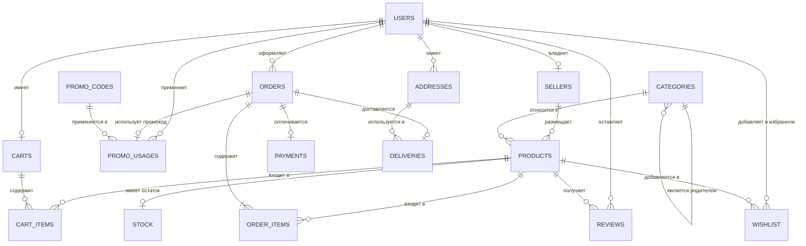
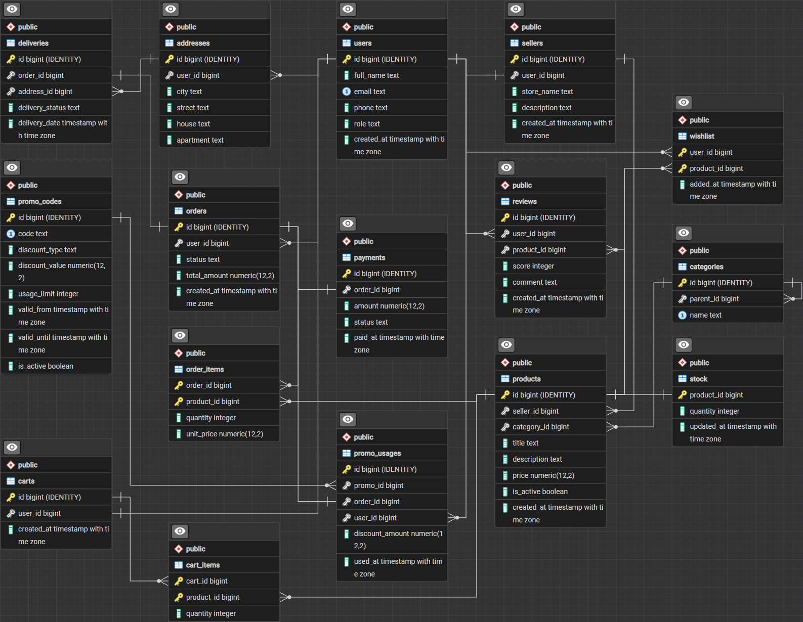

# Лабораторная работа №1. Проектирование и создание структуры базы данных

## 1. Анализ предметной области и бизнес-правила

Маркетплейс — площадка, объединяющая продавцов и покупателей: продавцы
размещают товары, покупатели просматривают их, добавляют в избранное или
корзину, оформляют заказы (в том числе с промокодом), которые оплачиваются
и доставляются.

Относительно базового кейса добавлено: **промокоды** (`promo_codes`,
`promo_usages`) и **избранное** (`wishlist`).

### Сущности

| Сущность | Назначение |
|---|---|
| users | учётные записи площадки |
| sellers | магазины, размещающие товары |
| categories | иерархический классификатор товаров |
| products | карточки товаров |
| stock | складские остатки |
| carts / cart_items | корзина и её позиции |
| orders / order_items | заказы и их позиции |
| payments | оплата заказов |
| deliveries / addresses | доставка и адреса |
| reviews | отзывы покупателей |
| promo_codes | промокоды на скидку |
| promo_usages | факты применения промокодов к заказам |
| wishlist | избранные товары пользователя |

### Бизнес-правила

**Пользователи и продавцы**

1\. Пользователь может владеть не более чем одним магазином-продавцом.

2\. Email пользователя уникален.

**Каталог**

3\. Товар принадлежит ровно одному продавцу и одной категории.

4\. Категория может иметь родительскую категорию (или быть корневой).

5\. Цена товара строго положительна.

6\. Название категории уникально.

**Складские остатки**

7\. Остаток товара неотрицателен; продажа не может превышать остаток.

**Избранное**

8\. Пара (пользователь, товар) в избранном уникальна.

**Корзина и заказы**

9\. У пользователя не более одной активной корзины.

10\. Заказ принадлежит одному покупателю и содержит хотя бы одну позицию.

11\. Позиция заказа хранит цену на момент покупки, а не текущую цену товара.

**Промокоды**

12\. Промокод действителен только в интервале `[valid_from, valid_until]`
при `is_active = true`.

13\. Один заказ использует не более одного промокода.

14\. Число применений промокода не превышает `usage_limit` (если задан).

15\. Сумма скидки фиксируется в момент применения и не пересчитывается при
изменении промокода.

**Оплата и доставка**

16\. Заказ оплачивается не более чем одним платежом.

17\. Заказ доставляется по одному адресу, принадлежащему покупателю.

**Отзывы**

18\. Отзыв оставляется конкретным пользователем к конкретному товару.

19\. Отзыв может оставить только пользователь, купивший этот товар.

## 2. Концептуальная ER-диаграмма

16 сущностей. Связи «многие-ко-многим» реализованы через ассоциативные
таблицы (`cart_items`, `order_items`, `promo_usages`, `wishlist`);
иерархическая связь (самоссылка) — в `categories`.

Нетривиальные связи:
- **categories — categories** — самоссылка через `parent_id`.
- **carts/orders — products** через `cart_items`/`order_items` (M:N) — с
  атрибутами `quantity` и (для заказа) `unit_price`, зафиксированным на
  момент покупки.
- **users — products** через `wishlist` (M:N, пара уникальна — правило 8).
- **orders — promo_codes** через `promo_usages` (M:N, но не более одного
  промокода на заказ — правило 13).

### Физическая ER-диаграмма

Физическая модель — это реализованная в PostgreSQL схема (см. раздел 5
«DDL-скрипт»). Диаграмма сгенерирована автоматически из фактической базы
данных средствами pgAdmin ERD Tool — на ней видны все 16 таблиц с типами
столбцов, пометками PK/NN и линиями связей с кардинальностями.

## 3. Приведение схемы к третьей нормальной форме

### Аномалия до нормализации

Гипотетический денормализованный вариант заказа, где данные о покупателе и
товаре хранятся прямо в строке. Первичный ключ составной — (order_id,
product_id), так как один заказ может содержать несколько товаров:

| order_id | product_id | user_id | user_email | user_city | product_title | quantity | unit_price |
|---|---|---|---|---|---|---|---|
| 1 | 101 | 10 | ivan@mail.ru | Москва | Клавиатура | 2 | 1500 |
| 1 | 102 | 10 | ivan@mail.ru | Москва | Мышь | 1 | 800 |
| 2 | 101 | 11 | anna@mail.ru | Казань | Клавиатура | 1 | 1500 |

**Нарушение 2НФ**: `product_title` зависит только от `product_id` — части
составного ключа, а не от всего ключа (order_id, product_id). Это
классическая частичная зависимость.

**Нарушение 3НФ**: `user_email` и `user_city` зависят от `user_id`, который
сам не входит в ключ таблицы. Возникает транзитивная зависимость: ключ →
`order_id` → `user_id` → `user_email`, `user_city` — неключевой атрибут
зависит от другого неключевого атрибута, а не напрямую от ключа.

Последствия: **вставка** — нельзя завести пользователя без заказа;
**обновление** — смена города требует правки во всех строках его заказов
(риск рассогласования); **удаление** — удаление единственного заказа стирает
и данные о пользователе.

### Устранение

Декомпозиция на `users`, `products`, `orders` и `order_items`: каждая
таблица хранит только атрибуты, зависящие от её полного первичного ключа,
без транзитивных зависимостей. То же правило выдержано во всей схеме —
например, `promo_usages.discount_amount` не дублирует `discount_value` из
`promo_codes`, а фиксирует фактическую скидку конкретного применения.

## 4. Первичные ключи

Для большинства таблиц выбран **суррогатный ключ**
(`BIGINT GENERATED ALWAYS AS IDENTITY`): он стабилен при изменении
бизнес-атрибутов (email, название), не зависит от будущих изменений правил
и упрощает связи между таблицами. Естественная уникальность там, где она
нужна по смыслу, обеспечена через `UNIQUE` (`users.email`,
`categories.name`, `promo_codes.code`), не становясь при этом PK.

Для ассоциативных таблиц `cart_items`, `order_items`, `wishlist`
использован **составной ключ из FK** — сама пара идентификаторов уже
уникальна и осмысленна, отдельный суррогат избыточен. Исключение —
`promo_usages`: по правилу 13 один заказ использует не более одного
промокода, то есть `order_id` сам по себе уже уникален в этой таблице
(обеспечено `UNIQUE(order_id)`) и является минимальным кандидатным ключом;
добавление `promo_id` в составной ключ было бы избыточным. Поэтому для
единообразия со стилем остальных таблиц выбран суррогатный `id`, а
уникальность `order_id` вынесена в отдельное ограничение `UNIQUE`.
Аналогично `stock` использует `product_id` как PK — это атрибут товара в
отношении 1:1 к нему.

| Таблица | Первичный ключ | Тип |
|---|---|---|
| users, sellers, categories, products, carts, orders, payments, reviews, addresses, deliveries, promo_codes, promo_usages | id | суррогатный |
| stock | product_id | естественный (= FK) |
| cart_items | (cart_id, product_id) | составной естественный |
| order_items | (order_id, product_id) | составной естественный |
| wishlist | (user_id, product_id) | составной естественный |

---

## 5. Иерархические данные

Дерево категорий реализовано способом «список смежности»: таблица
`categories` содержит самоссылку `parent_id REFERENCES categories(id)`.
Корневая категория имеет `parent_id = NULL`; у любой дочерней категории
`parent_id` указывает на строку той же таблицы. Такой способ не требует
отдельной структуры для хранения иерархии и позволяет добавлять уровни
вложенности произвольной глубины без изменения схемы.

Для удаления родительской категории выбрано правило `ON DELETE RESTRICT`:
нельзя удалить категорию, пока у неё есть дочерние категории или товары —
это защищает от «зависания» товаров с несуществующей категорией. Обход
всего поддерева (получение категории со всеми потомками) выполняется
рекурсивным CTE. Для ускорения поиска дочерних категорий по `parent_id` создан индекс `idx_categories_parent`.

## 6. Словарь данных

Полный словарь данных по всем 16 таблицам (столбцы, типы, ограничения,
назначение) вынесен в отдельный файл — [`data_dictionary.md`](./data_dictionary.md).

---

## Итог

В рамках лабораторной работы спроектирована и реализована схема базы данных
маркетплейса: проведён анализ предметной области и сформулировано 19
бизнес-правил, построена концептуальная ER-диаграмма из 16 сущностей с
одной иерархической связью (`categories`) и четырьмя связями
«многие-ко-многим» через ассоциативные таблицы (`cart_items`,
`order_items`, `wishlist`, `promo_usages`). Схема приведена к третьей
нормальной форме, для каждой таблицы обоснован выбор первичного ключа
(суррогатный — для большинства сущностей, составной естественный — для
ассоциативных таблиц). Схема реализована единым воспроизводимым DDL-скриптом
(`schema.sql`) со всеми необходимыми ограничениями целостности (`PRIMARY
KEY`, `FOREIGN KEY`, `NOT NULL`, `UNIQUE`, `CHECK`, `DEFAULT`) и осознанным
выбором правил `ON DELETE`/`ON UPDATE`; составлен словарь данных по всем 16
таблицам.
