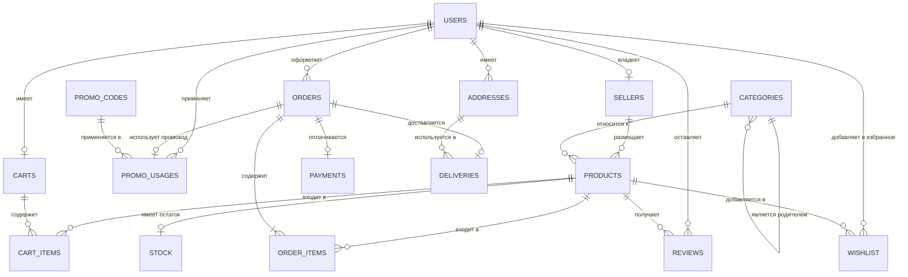

# Лабораторная работа №1. Проектирование и создание структуры базы данных

## 1. Анализ предметной области и бизнес-правила

### Описание предметной области

Разрабатываемая база данных обслуживает маркетплейс — электронную площадку,
объединяющую независимых продавцов и покупателей. Продавцы размещают товары
в каталоге, покупатели просматривают товары, добавляют их в избранное или
в корзину, оформляют заказы, которые оплачиваются и доставляются. Заказ
может быть оформлен с применением промокода.

Относительно базового кейса предметная область расширена двумя блоками:

- **промокоды** — общие скидочные коды с ограничением по сроку действия и
  количеству применений;
- **избранное** — пользователь может сохранять товары в избранное.

### Основные сущности

| Сущность | Назначение |
|---|---|
| users | учётные записи площадки |
| sellers | магазины, размещающие товары |
| categories | иерархический классификатор товаров |
| products | карточки товаров |
| stock | складские остатки |
| carts / cart_items | корзина и её позиции |
| orders / order_items | заказы и их позиции |
| payments | оплата заказов |
| deliveries / addresses | доставка и адреса |
| reviews | отзывы покупателей |
| promo_codes | промокоды на скидку |
| promo_usages | факты применения промокодов к заказам |
| wishlist | избранные товары пользователя |

### Бизнес-правила

**Пользователи и продавцы**

1\. Пользователь может быть покупателем и одновременно владельцем не более
чем одного магазина-продавца.

2\. Email пользователя уникален.

**Каталог**

3\. Товар принадлежит ровно одному продавцу и ровно одной категории.

4\. Категория может иметь родительскую категорию; категория без родителя —
корневая.

5\. Цена товара строго положительна.

6\. Название категории уникально.

**Складские остатки**

7\. Остаток товара на складе неотрицателен; товар нельзя продать в
количестве, превышающем остаток.

**Избранное**

8\. Один пользователь может добавить один и тот же товар в избранное только
один раз.

**Корзина и заказы**

9\. У пользователя не более одной активной корзины.

10\. Заказ принадлежит одному покупателю и содержит хотя бы одну позицию.

11\. Позиция заказа хранит цену товара на момент покупки, независимо от
последующего изменения цены товара в каталоге.

**Промокоды**

12\. Промокод действителен только в интервале `[valid_from, valid_until]` и
только пока активен (`is_active = true`).

13\. Один заказ может использовать не более одного промокода.

14\. Число применений промокода не превышает установленный лимит
(`usage_limit`), если лимит задан.

15\. Сумма скидки фиксируется в момент применения промокода к заказу и не
пересчитывается при последующем изменении параметров промокода.

**Оплата и доставка**

16\. Заказ может быть оплачен не более чем одним платежом.

17\. Заказ доставляется по ровно одному адресу, принадлежащему покупателю.

**Отзывы**

18\. Отзыв оставляется конкретным пользователем к конкретному товару.

19\. Отзыв на товар может оставить только пользователь, ранее купивший этот
товар (проверка реализуется серверной логикой в лабораторной работе №5;
здесь правило зафиксировано как ограничение предметной области).

## 2. Концептуальная ER-диаграмма

Диаграмма описывает сущности предметной области и связи между ними без
привязки к типам данных и реализации в конкретной СУБД. Всего выделено
16 сущностей. Схема содержит несколько связей «многие-ко-многим»,
реализуемых через ассоциативные таблицы (`cart_items`, `order_items`,
`promo_usages`, `wishlist`), и иерархическую связь (самоссылку) в сущности
`categories`.

### Пояснения к связям

- **users — sellers (1 : 0..1)** — пользователь может не иметь магазина или
  иметь ровно один.
- **sellers — products (1 : N)** — продавец размещает много товаров, товар
  принадлежит одному продавцу.
- **categories — categories (иерархия, самоссылка)** — категория может
  иметь ровно одну родительскую категорию (или не иметь — корневая) и
  много дочерних.
- **carts — products через cart_items (M : N)** — корзина содержит много
  товаров, товар может лежать во многих корзинах; связь несёт
  дополнительный атрибут `quantity`.
- **orders — products через order_items (M : N)** — аналогично корзине, с
  атрибутами `quantity` и `unit_price` (цена фиксируется на момент покупки).
- **users — products через wishlist (M : N)** — пользователь добавляет в
  избранное много товаров, товар может быть в избранном у многих
  пользователей; пара (user_id, product_id) уникальна (правило 8).
- **orders — promo_codes через promo_usages (M : N в общем случае, но
  ограничено правилом 13 до 0..1 применения на заказ)** — промокод может
  быть применён во многих заказах (до достижения `usage_limit`), но один
  заказ использует не более одного промокода.
- **orders — payments (1 : 0..1)** и **orders — deliveries (1 : 0..1)** —
  заказ может быть ещё не оплачен/не отправлен в доставку.
- **addresses — deliveries (1 : N)** — по одному адресу может быть оформлено
  несколько доставок (например, разные заказы одного пользователя).

## 3. Приведение схемы к третьей нормальной форме

### Пример аномалии до нормализации

Рассмотрим гипотетический (ненормализованный) вариант таблицы заказов, в
который для «удобства» сразу добавлены данные о покупателе и о товаре —
частое решение, если не проводить анализ функциональных зависимостей:

| order_id (PK) | user_id | user_email | user_city | product_id | product_title | quantity | unit_price |
|---|---|---|---|---|---|---|---|
| 1 | 10 | ivan@mail.ru | Москва | 101 | Клавиатура | 2 | 1500 |
| 1 | 10 | ivan@mail.ru | Москва | 102 | Мышь | 1 | 800 |
| 2 | 11 | anna@mail.ru | Казань | 101 | Клавиатура | 1 | 1500 |

Здесь первичным ключом должна была бы служить пара (order_id, product_id),
но `user_email`, `user_city` и `product_title` зависят не от всего этого
составного ключа, а только от его части (`user_id` и `product_id`
соответственно) — это нарушение **второй нормальной формы (2НФ)**, а
`user_city`, зависящий от `user_id`, который сам не является частью ключа
таблицы заказов, дополнительно демонстрирует транзитивную зависимость,
нарушающую **третью нормальную форму (3НФ)**.

Эта денормализованная структура порождает классические аномалии:

- **аномалия вставки** — нельзя зарегистрировать нового пользователя, пока
  он не оформит хотя бы один заказ, так как email и город хранятся только
  внутри строк заказа;
- **аномалия обновления** — если пользователь `ivan@mail.ru` меняет город,
  придётся обновить `user_city` в каждой строке, где встречается его
  `user_id` (в примере — в двух строках заказа №1); если обновить только
  одну, данные рассогласуются;
- **аномалия удаления** — если удалить последний заказ пользователя (или
  единственную позицию заказа), теряются также и его контактные данные,
  хотя пользователь как сущность должен продолжать существовать.

### Как аномалия устранена

Устранение достигается декомпозицией таблицы на отдельные отношения, каждое
из которых описывает ровно одну сущность:

- **`users`** — хранит `email`, `full_name` и прочие атрибуты пользователя
  ровно один раз, независимо от количества его заказов;
- **`products`** — хранит `title` и `price` товара ровно один раз,
  независимо от того, в скольких заказах он участвует;
- **`orders`** — хранит только атрибуты, зависящие от заказа как целого
  (`user_id`, `status`, `total_amount`, `created_at`);
- **`order_items`** — ассоциативная таблица с составным ключом
  (`order_id`, `product_id`), хранящая только то, что действительно зависит
  от пары «заказ + товар» (`quantity`, `unit_price`).

После декомпозиции каждый неключевой атрибут зависит от полного первичного
ключа своей таблицы и не зависит транзитивно от атрибутов, не входящих в
ключ, — схема находится в 3НФ. Это же правило применено при проектировании
всех остальных таблиц (например, `promo_usages` хранит `discount_amount`
как атрибут самого факта применения промокода, а не дублирует
`discount_value` из `promo_codes` — правило 15).

## 4. Первичные ключи

Для всех сущностей, кроме ассоциативных таблиц и таблицы `stock`, выбран
**суррогатный первичный ключ** типа `BIGINT GENERATED ALWAYS AS IDENTITY`.
Обоснование:

- Суррогатный ключ стабилен: он не меняется при изменении бизнес-атрибутов
  строки (например, если пользователь сменит email, а товар — название).
- Он не зависит от изменений бизнес-правил: если в будущем понадобится
  разрешить пользователю несколько магазинов или разрешить не уникальный
  email в разных доменах, естественный ключ пришлось бы пересматривать, а
  суррогатный остаётся неизменным.
- Он компактен и одинаков по типу во всех таблицах, что упрощает
  реализацию внешних ключей и соединения (JOIN) в последующих работах.

Единственное явное **естественное ограничение уникальности (UNIQUE)**,
дополняющее суррогатный ключ, введено там, где предметная область требует
единственности значения независимо от PK: `users.email`,
`categories.name`, `promo_codes.code`.

| Таблица | Первичный ключ | Тип | Обоснование |
|---|---|---|---|
| users | id | суррогатный | учётная запись может менять email/имя; PK должен быть стабилен |
| sellers | id | суррогатный | магазин может сменить название |
| categories | id | суррогатный | нужен для самоссылки `parent_id`; название категории меняемо |
| products | id | суррогатный | название и цена товара могут изменяться |
| stock | product_id | естественный (= FK) | остаток — атрибут товара в отношении 1:1 к нему, отдельный суррогат избыточен |
| carts | id | суррогатный | техническая сущность, не имеющая естественного идентификатора |
| cart_items | (cart_id, product_id) | естественный составной | пара однозначно определяет позицию корзины; ассоциативная таблица M:N |
| orders | id | суррогатный | заказ идентифицируется системой, а не своими атрибутами |
| order_items | (order_id, product_id) | естественный составной | ассоциативная таблица M:N; товар входит в заказ не более одного раза |
| payments | id | суррогатный | техническая сущность платежа |
| reviews | id | суррогатный | пользователь теоретически мог бы оставить более одного отзыва (если правило это допускает) |
| addresses | id | суррогатный | пользователь может иметь несколько одинаковых по смыслу адресов |
| deliveries | id | суррогатный | техническая сущность доставки |
| promo_codes | id | суррогатный | `code` уникален как атрибут (UNIQUE), но PK — суррогат для стабильности FK в `promo_usages` |
| promo_usages | id | суррогатный | связь M:N с атрибутами (`discount_amount`, `used_at`); суррогат проще, чем составной ключ из трёх FK |
| wishlist | (user_id, product_id) | естественный составной | ассоциативная таблица M:N; пара уникальна по правилу 8 |

Для ассоциативных таблиц, где сама пара внешних ключей и есть смысловой
идентификатор записи (`cart_items`, `order_items`, `wishlist`), выбран
**составной естественный ключ** — он одновременно служит и первичным
ключом, и ограничением уникальности пары, что избавляет от необходимости
вводить дополнительный суррогатный столбец. Таблица `promo_usages`
выделена в отдельный случай: у неё есть собственные значимые атрибуты
(`discount_amount`, `used_at`), не привязанные к паре (promo_id, order_id)
жёстко (например, теоретически можно расширить правило и допустить
частичные возвраты промокода), поэтому для неё выбран суррогатный `id`.

---

*Дальнейшие разделы (иерархические данные, DDL-скрипт, физическая
ER-диаграмма, словарь данных) будут добавлены следующими коммитами по мере
выполнения работы.*
